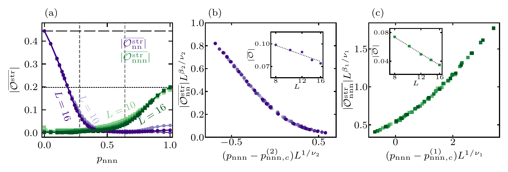

# AKLT: Measurement-Only Spin-1 Dynamics

[](https://github.com/ka784-jpg/AKLT/actions/workflows/tests.yml)
[](LICENSE)

Julia simulations of how competing local projections change topological order
and entanglement in a quantum spin chain. The repository contains the underlying
matrix product state (MPS) and exact-statevector simulation sources, a small
reproducible example, and tests against independent dense calculations.

**Paper:** Kemal Aziz, Haining Pan, and J. H. Pixley,
[*Measurement-Only Dynamical Phase Transitions in Spin-1 Chains*](https://arxiv.org/abs/2609.26941).

[Run an example](#quickstart) | [Physics and algorithms](docs/SCIENCE.md) |
[Paper figures](docs/RESULTS.md) | [Reproducibility](docs/REPRODUCIBILITY.md) |
[Simulation interfaces](RUNNING.md)



**What the calculation probes.** Competing nearest-neighbor (NN) and
next-nearest-neighbor (NNN) AKLT projectors produce finite-size signatures
consistent with an extended critical regime between two distinct endpoint
states. The figure is from the paper, not from the small example below.
[Interpretation, original PDF, and source mapping](docs/RESULTS.md#string-order-and-phase-boundaries-figure-4).

## Quickstart

Install [Julia](https://julialang.org/downloads/) **1.12.6** and Git, then run
these commands in a terminal. They work in PowerShell and POSIX shells.

```sh
git clone https://github.com/ka784-jpg/AKLT.git
cd AKLT
julia --project=examples -e 'using Pkg; Pkg.instantiate()'
julia --project=examples --threads=1 examples/quickstart.jl
```

The lightweight environment installs `DelimitedFiles`, not the MPS stack.
The first Julia run includes compilation; the simulation itself is small:
10 spin-1 sites, 24 sweeps, one trajectory, and seed `1234`.
No cluster, GPU, credentials, or external datasets are required.

The run creates `results/quickstart/` containing:

| Output | Meaning |
| --- | --- |
| `summary.csv` | Five sampled sweeps, signed spatial means, and their absolute values |
| `samples.csv` | All 25 spatial samples with sweep, origin, seed, and NN/NNN observables |
| `metadata.toml` | Parameters, conventions, Julia version, and simulation-source SHA256 |
| `raw/` | The four unchanged-format outputs of the archived simulation engine |

For the default configuration, the final sweep has
`mean_nn` approximately `-0.03832792559` and `mean_nnn` approximately
`0.03222625613`. The [reference CSV](examples/expected/summary.csv) and automated
test check the full output with numerical tolerances.

Reruns do **not** overwrite existing output. Choose a fresh directory:

```sh
julia --project=examples examples/quickstart.jl --output results/another_run
julia --project=examples tests/quickstart_smoke.jl
julia --project=examples tests/statevector_smoke.jl
```

Parameters live in [`examples/quickstart.toml`](examples/quickstart.toml).
The [example interface guide](examples/README.md) explains every field,
output column, and supported error case. One short trajectory illustrates the
workflow; it is not an estimate of the paper's phase boundaries or exponents.

## Scope

**Included:** forced, normalized spin-1 projections; TT and dimer MPS models;
NN-NNN statevector dynamics; string order, entanglement, Renyi entropy,
preparation fidelity, and bond-dimension diagnostics; selected paper figures;
source provenance; and small numerical regression tests.

**Not included:** Born-rule sampling of measurement outcomes, a hardware
implementation, the full raw-data archive, the paper's Python plotting/fitting
pipeline, or a one-command reproduction of every paper figure. Some historic
campaigns cannot be assigned an exact source revision from the available
records. These limitations are [documented explicitly](FIGURE_PROVENANCE.md#important-limitations).

## Code organization

| Path | Role |
| --- | --- |
| [`examples/`](examples/) | Validated entry point with named configuration and non-overwriting outputs |
| [`simulations/mps/`](simulations/mps/) | Trivial, dimer, fidelity, and bond-dimension campaign sources |
| [`simulations/statevector/`](simulations/statevector/) | NN-NNN order, entropy, relaxation, and Renyi campaign sources |
| [`tests/`](tests/) | Dense-reference checks, seeded trajectories, output contracts, and integrity checks |
| [`docs/`](docs/) | Physics, figure explanations, and reproducibility notes |
| [`vendor/QuantumCircuitsMPS2/`](vendor/QuantumCircuitsMPS2/) | Attributed local dependency snapshot |

The original root files `AKLT_nnn_nn` and `NN-NNN Forced` remain unchanged
for historical reference. The campaign sources are preserved rather than
presented as a new unified package API. New examples and tests wrap them without
changing their numerical algorithms.

## MPS simulations and testing

The root `Project.toml` and `Manifest.toml` lock the full validated environment.
Installing it is heavier than running the lightweight example.

```sh
julia --project=. -e 'using Pkg; Pkg.instantiate(; allow_autoprecomp=false)'
julia --project=. --threads=1 --compiled-modules=no --compile=min -O0 tests/mps_smoke.jl
```

The MPS test uses small TT/dimer systems; the compiler flags avoid lengthy cold
cache compilation and are not production-performance recommendations.
[RUNNING.md](RUNNING.md) contains campaign commands and argument conventions.
Full statevectors scale as `3^L`; production-size sweeps can be expensive.

[GitHub Actions](https://github.com/ka784-jpg/AKLT/actions/workflows/tests.yml)
runs the example and statevector tests on Linux and Windows, plus small MPS
tests on Linux. Tests cover projector algebra, normalized updates against a
dense reference, repeated-seed trajectories, entropy units, input validation,
output preservation, and source/figure checksums. See
[VALIDATION.md](VALIDATION.md) for the locally observed results and limitations.

## Attribution, license, and contributions

Research code and documentation: [MIT](LICENSE). The vendored dependency keeps
its [BSD 3-Clause license](vendor/QuantumCircuitsMPS2/LICENSE). Paper figures
are excluded from the code license and retain their publication terms;
see [NOTICE.md](NOTICE.md).

Please cite the [paper](https://doi.org/10.48550/arXiv.2609.26941) when using
the scientific results, and identify the repository commit when using this
implementation. Bug reports should include the command, configuration, Julia
version, and the first error message. See [CONTRIBUTING.md](CONTRIBUTING.md)
for a focused test checklist.
