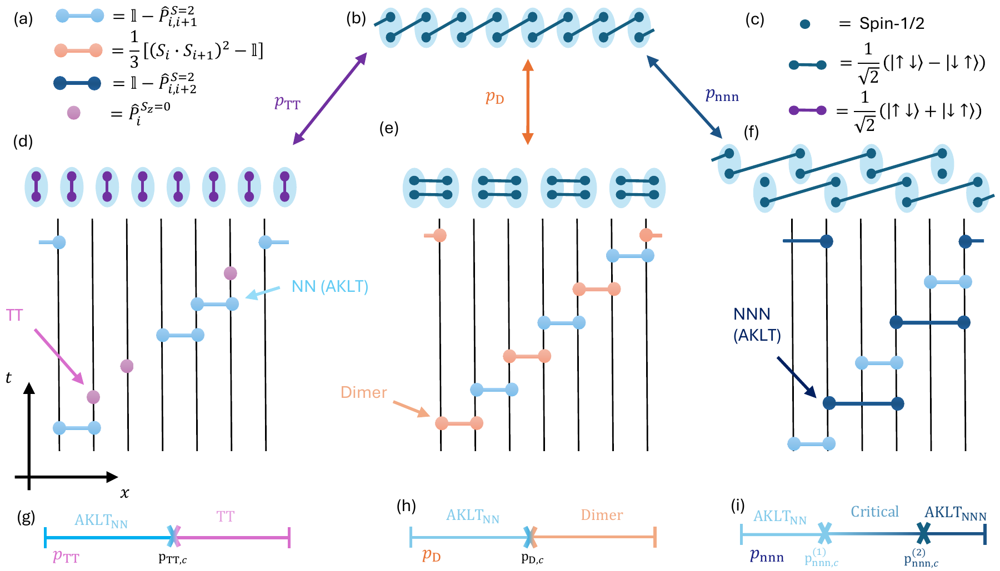
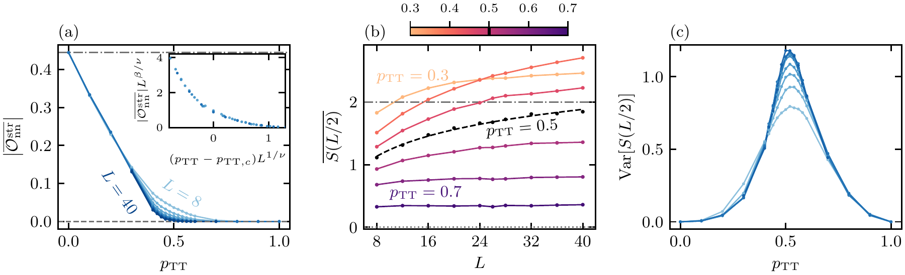
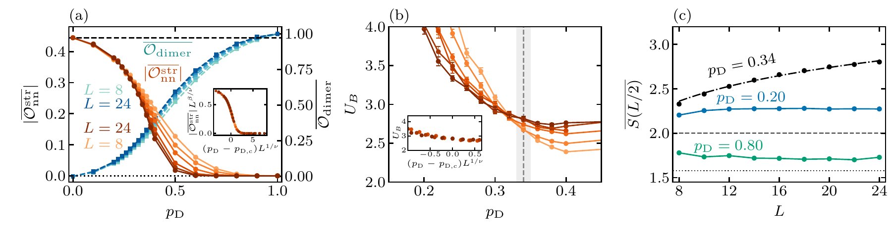
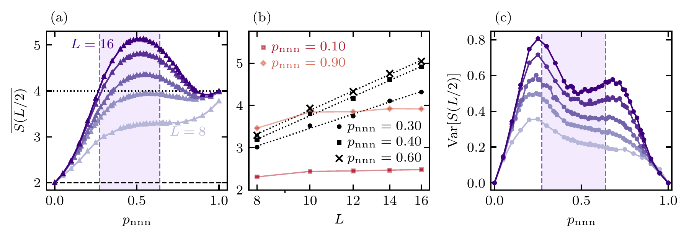
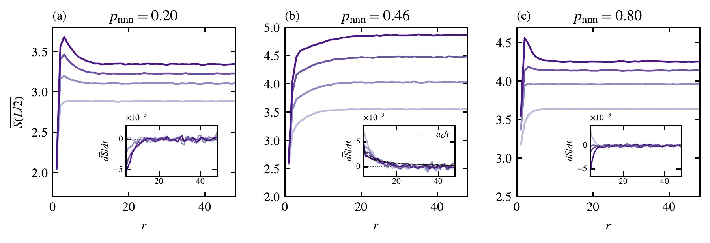
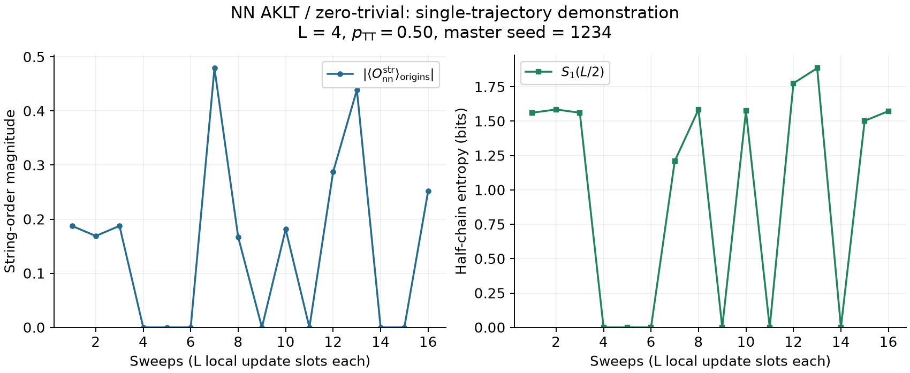
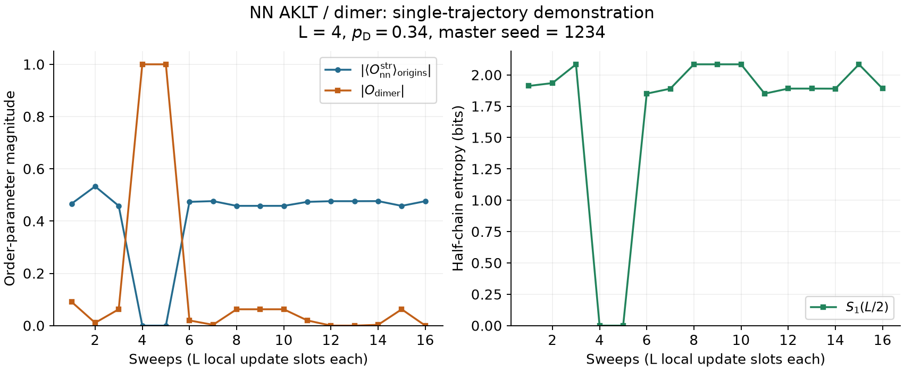

# Results: trivial, dimer, and NN-NNN models

**Paper:** Kemal Aziz, Haining Pan, and J. H. Pixley,
[*Measurement-Only Dynamical Phase Transitions in Spin-1 Chains*](https://arxiv.org/abs/2609.26941).

[Trivial / zero model](#spt-to-trivial-product-state-figure-2) |
[Dimer model](#spt-to-dimerized-state-figure-3) |
[NN-NNN model](#string-order-and-phase-boundaries-figure-4) |
[Runnable examples](../examples/README.md#model-gallery)

| Model | Competing operation | Paper results below | Small example |
| --- | --- | --- | --- |
| NN AKLT / trivial (TT or zero) | Single-site projection onto spin-z = 0 | Fig. 2: string order, entropy, entropy variance | [Plot, data, and run command](../examples/trivial/README.md) |
| NN AKLT / dimer | Spin-0 projection on the selected odd bonds | Fig. 3: string and dimer order, Binder statistic, entropy | [Plot, data, and run command](../examples/dimer/README.md) |
| NN / NNN AKLT | NN versus NNN spin-sector projections | Figs. 4, 6, 11: order, entanglement, relaxation | [Plot, data, and run command](../examples/nnn/README.md) |

These are existing manuscript figures, not new simulation results generated by
the examples. Figure numbers follow the 14-figure manuscript identified in the
[source map](../FIGURE_PROVENANCE.md). Original PDF assets are included unchanged; PNGs provide
readable previews. The [asset manifest](figures/manifest.json) records filenames
and SHA256 hashes. All figures are credited to Kemal Aziz, Haining Pan, and
J. H. Pixley; see [attribution and publication terms](figures/ATTRIBUTION.md).

## Competing local projections: Figure 1

The schematic connects the local update rule to three competing states:
trivial, dimerized, and NNN AKLT. The virtual spin-1/2 construction depicts
the states; the simulated physical sites are spin-1. Colored circuit elements
represent normalized projections, not unitary gates or Born-sampled outcomes.

[Original PDF](figures/fig01_protocol.pdf) |
[Numerical-model explanation](SCIENCE.md#three-competing-projector-models).
This is a schematic, so no numerical data-production command applies.

## SPT to trivial product state: Figure 2

**Question.** How does the Haldane SPT lose its string order when local
projections favor the featureless zero-spin product state? The horizontal
parameter `p_TT` is the probability of the competing single-site operation;
the simulation runner takes `p_nn = 1 - p_TT`.

| Panel | What is plotted | What to look for |
| --- | --- | --- |
| (a) | Magnitude of circuit-averaged NN string order versus `p_TT`; inset: finite-size collapse | Loss of string order with increasing competing probability. The thermodynamic NN-AKLT reference is 4/9; the trivial endpoint is zero. |
| (b) | Mean half-chain entropy versus chain length | The critical slice is fitted logarithmically; behavior away from it is compared with the area-law phases. Entropy is in bits. |
| (c) | Trajectory-to-trajectory entropy variance versus `p_TT` | The peak supplies a complementary transition diagnostic. |

The manuscript reports `p_TT,c = 0.50(1)`, `nu = 1.4(2)`, and
`beta = 2.0(3)` from the finite-size string-order collapse. These are paper
estimates, not fits to the small example.

[Original Figure 2 PDF](figures/fig02_trivial.pdf) |
[MPS simulation source](../simulations/mps/trivial/run_zero_static.jl) |
[Trivial example with plot and CSV](../examples/trivial/README.md).

The archived implementation uses a normalized `exp(50 * |0><0|)` filter for
the zero operation, a finite-strength approximation to the rank-one projector.
The example preserves that implementation rather than silently replacing it.
Exact historical source revisions for every plotted contribution remain
unverified; see the [provenance limitations](../FIGURE_PROVENANCE.md#important-limitations).

## SPT to dimerized state: Figure 3

**Question.** How does competition with a singlet-dimer pattern change
topological and valence-bond order? Here `p_D` is the dimer-projector probability
on the selected odd bonds. On the other bonds the corresponding competing
branch is identity. The runner takes `p_nn = 1 - p_D`; this is not uniform
singlet projection on every bond.

| Panel | What is plotted | What to look for |
| --- | --- | --- |
| (a) | NN string order (left scale) and dimer order (right scale); inset: string-order collapse | String order decreases while explicit dimer order grows. The two vertical scales should not be conflated. |
| (b) | Centered Binder statistic for the dimer observable; inset: its collapse | Complementary finite-size evidence using the transition parameters from panel (a). Errors use trajectory-block jackknife resampling. |
| (c) | Mean half-chain entropy versus chain length | Logarithmic critical behavior is contrasted with the two area-law regimes. The reference lines are 2 bits and log2(3) bits for the indicated endpoint/cut conventions. |

The manuscript quotes `p_D,c = 0.34(1)`, `nu = 1.3(2)`, and
`beta = 0.22(3)` from string-order scaling. The Binder analysis is
complementary, not a separate fit performed by the demo. Entropy in a dimer
state depends on where the subsystem boundary cuts the dimers.

[Original Figure 3 PDF](figures/fig03_dimer.pdf) |
[Sector-aware MPS runner](../simulations/mps/dimer/run_dimer_sector_cli.jl) |
[Binder sampling runner](../simulations/mps/dimer/run_dimer_binder_only_cli.jl) |
[Dimer example with plot and CSV](../examples/dimer/README.md).

The full figure combines more than one producer/campaign family. The
[figure-to-code map](../FIGURE_PROVENANCE.md) identifies these sources;
the short example is not the production Binder or collapse analysis.

## String order and phase boundaries: Figure 4

Panel (a) compares the two order parameters as the NNN-projector probability
changes. Panels (b) and (c) use finite-size scaling to examine the two phase
boundaries. The small finite-system order parameters should not be described
as exactly zero throughout the middle interval; their size dependence and the
entanglement evidence are the relevant diagnostics.

**Model.** The competing operation acts on next-nearest-neighbor spin-1 sites.
`p_nnn` is its probability, while the engine takes `p_nn = 1 - p_nnn`.
The NNN endpoint consists of two interwoven AKLT chains. The manuscript's
finite-size estimates place the boundaries near `p_nnn = 0.28(1)` and
`0.64(1)`; the evidence for the intermediate regime uses both the order
diagnostics here and Figure 6 below.

[Original PDF](figures/fig04_string_order.pdf) |
[Order-sampling engine](../simulations/statevector/order/AKLTStatevectorOrderOnly.jl) |
[Campaign worker](../simulations/statevector/order/run_order_worker.jl).

[NN-NNN example with plot and CSV](../examples/nnn/README.md).

The quickstart exercises this engine, but one `L=10` trajectory cannot reproduce
the figure's ensemble averages, collapses, or fitted exponents.

## Entanglement and finite-size behavior: Figure 6

Panel (a) shows the enhanced half-chain entropy in the intermediate interval.
Panel (b) contrasts size dependence inside that interval with the near-endpoint
behavior. Panel (c) adds the variance as a fluctuation diagnostic. Together
with string-order scaling, these finite-size observations support the paper's
interpretation of an extended critical regime; they are not a proof of a
particular continuum theory.

[Original PDF](figures/fig06_entanglement.pdf) |
[Stationary statevector engine](../simulations/statevector/static/AKLTStatevector.jl).
The mapping identifies the relevant producer family; exact historical hashes
are not known for every aggregate contribution.

## Relaxation and preparation time: Figure 11

The three panels compare entropy relaxation in the NN-AKLT, intermediate,
and NNN-AKLT regimes. The derivative insets help distinguish transient growth
from an approximately saturated signal over the accessible time window.
These curves motivate checking equilibration and recording time units before
fitting stationary observables. The finite-time plateaus are not a universal
preparation-time guarantee.

[Original PDF](figures/fig11_relaxation.pdf) |
[Relaxation engine](../simulations/statevector/relaxation/AKLTStatevectorNNNZ.jl) |
[Entropy runner](../simulations/statevector/relaxation/run_entropy.jl).
The paper's aggregate combines multiple saturation campaigns.

## Reproducing versus displaying results

### Plots you can run locally

Each example folder contains an actual generated PNG, its reference CSV,
metadata and seed, and commands to rerun the preserved engine or just replot
the saved data. All use periodic boundaries and a uniform product initial
state. They illustrate output conventions and finite-time trajectories, not
the paper's large ensembles or critical exponents.

| Trivial / zero | Dimer | NN-NNN |
| --- | --- | --- |
|  |  |  |
| [Run or replot](../examples/trivial/README.md) | [Run or replot](../examples/dimer/README.md) | [Run or replot](../examples/nnn/README.md) |

The NN string-order magnitude is taken **after** averaging the signed
observable over the recorded spatial origins. These examples do not estimate
trajectory-ensemble error bars. Temporal fluctuations in a single trajectory
are not the trajectory-to-trajectory entropy variance in Figures 2 and 6.

This repository includes the simulation sources and original figure assets,
but not the full production datasets or analysis notebooks that turn those
datasets into these plots. The [reproducibility guide](REPRODUCIBILITY.md)
separates the runnable reference example, preserved source evidence, and the
additional inputs needed for a full paper reproduction. The complete
[14-figure map](../FIGURE_PROVENANCE.md) also documents an unresolved fidelity
initialization/provenance discrepancy.
