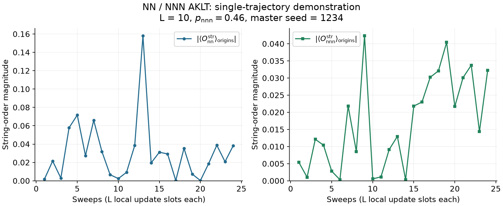

# NN-NNN AKLT model

## Paper reference: Figure 4


From Aziz, Pan, and Pixley, [arXiv:2609.26941](https://arxiv.org/abs/2609.26941).
The figure shows both string orders and the two finite-size collapses.
[Panel guide and original PDF](../../docs/RESULTS.md#string-order-and-phase-boundaries-figure-4).
The same guide includes entropy (Figure 6) and relaxation (Figure 11).
Paper figures retain CC BY 4.0 terms, separate from the MIT code license.

## Generated example: one small trajectory



The exact-statevector engine runs `L=10`, `p_nnn=0.46`, 24 full sweeps,
seed `1234`, periodic boundaries, and a uniform product initial state.
It records every sweep, unlike the five late-time points in the root quickstart.
The engine receives `p_nn=0.54`. One sweep contains `L` update slots.

Both panels take the absolute value **after** averaging the signed string
correlator at separation `L/2` over `L/2` origins. The two y-axis scales differ.
The NNN observable has two adjacent spin-z operators at each end, not the
ordinary two-endpoint NN string. This single finite-system trajectory cannot
establish a critical phase, fit its boundaries, or reproduce ensemble averages.

## Run and plot

From the repository root, with Julia 1.12.6 and Python 3.11+:

```sh
julia --project=examples -e 'using Pkg; Pkg.instantiate()'
julia --project=examples --threads=1 examples/quickstart.jl --config examples/nnn/config.toml --output results/nnn_example
python -m pip install -r examples/requirements-plot.txt
python examples/plot_trace.py nnn results/nnn_example results/nnn_example/trace.png
```

The lightweight environment does not install the MPS dependencies. Change
`--output` to a new directory for a rerun; existing outputs are not overwritten.
The [configuration](config.toml) uses the [checked quickstart interface](../README.md#inputs).

Replot the saved data without Julia:

```sh
python examples/plot_trace.py nnn examples/nnn/expected results/nnn_saved.png
```

[Reference CSV](expected/summary.csv) | [Run metadata](expected/metadata.toml) |
[Simulation source](../../simulations/statevector/order/AKLTStatevectorOrderOnly.jl).
Fresh runs also contain all signed spatial samples and unchanged-format raw output.
